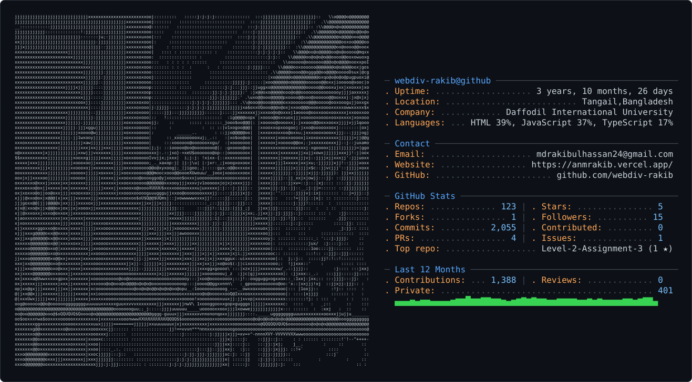

<!-- ========================================== -->
<!--                 HEADER                     -->
<!-- ========================================== -->

  <!-- Typing SVG Header -->
  

  <!-- Profile Views, WakaTime & Social Badges -->
  

    
    
  

  <!-- Social Links -->
  

    
    
    
    
    
  

  <!-- Custom Top GitHub Contribution Graph -->
  

    
  

<!-- Custom Theme-Aware SVG Banner -->

  <picture>
    <source media="(prefers-color-scheme: dark)" srcset="dark_mode.svg" />
    <source media="(prefers-color-scheme: light)" srcset="light_mode.svg" />
    
  </picture>

 

<!-- ========================================== -->
<!--                 ABOUT ME                   -->
<!-- ========================================== -->

  

    <i>"I’m a curious learner and passionate web developer who enjoys turning ideas into clean, functional web applications. I love exploring modern technologies, solving real-world problems, and continuously sharpening my engineering skills."</i>
  

<!-- ========================================== -->
<!--                TECH STACK                  -->
<!-- ========================================== -->
<h2 align="center">🛠️ Tech Stack & Arsenal</h2>

<table align="center" width="100%">
  <thead>
    <tr>
      <th width="33%">💻 Core Languages</th>
      <th width="33%">🎨 Front-End</th>
      <th width="33%">⚙️ Back-End & Database</th>
    </tr>
  </thead>
  <tbody>
    <tr>
      <td align="center">
        
      </td>
      <td align="center">
        
      </td>
      <td align="center">
        
      </td>
    </tr>
  </tbody>
  <thead>
    <tr>
      <th>🔎 Familiar With</th>
      <th>🧰 Tools & Platforms</th>
      <th>🖥️ Operating Systems</th>
    </tr>
  </thead>
  <tbody>
    <tr>
      <td align="center">
        
      </td>
      <td align="center">
        
      </td>
      <td align="center">
        
      </td>
    </tr>
  </tbody>
</table>

 

<!-- ========================================== -->
<!--               GITHUB STATS                 -->
<!-- ========================================== -->
<h2 align="center">📊 GitHub Analytics & Activity</h2>

  
  

  

 

<!-- ========================================== -->
<!--             DEPLOYED PROJECTS              -->
<!-- ========================================== -->
<h2 align="center">🚀 Featured Projects</h2>

### ⚡ Dynamic & Custom API Applications
<table style="width: 100%; border-collapse: collapse;">
  <tr>
    <td align="center" width="25%">
       
      <b>Peddy Pet Shop</b> 
      <a href="https://peddy-peddy.netlify.app/">🌐 Live Demo</a>
    </td>
    <td align="center" width="25%">
       
      <b>PH Tube</b> 
      <a href="https://ph-tube-like-yt.netlify.app/">🌐 Live Demo</a>
    </td>
    <td align="center" width="25%">
       
      <b>Swift E-Commerce</b> 
      <a href="https://swift-cart-1.netlify.app/">🌐 Live Demo</a>
    </td>
    <td align="center" width="25%">
       
      <b>Knowledge Cafe</b> 
      <a href="https://knowledge-cafe-2.netlify.app/">🌐 Live Demo</a>
    </td>
  </tr>
  <tr>
    <td align="center" width="25%">
       
      <b>Dream 11</b> 
      <a href="https://dream-11-select.netlify.app/">🌐 Live Demo</a>
    </td>
    <td align="center" width="25%">
       
      <b>CS Ticket System</b> 
      <a href="https://cs-ticket-system-eta.vercel.app/">🌐 Live Demo</a>
    </td>
    <td align="center" width="25%">
       
      <b>Boi Poka</b> 
      <a href="https://boi-poka-brown.vercel.app/">🌐 Live Demo</a>
    </td>
    <td align="center" width="25%">
       
      <b>Hero Store</b> 
      <a href="https://hero-store-bd.vercel.app/">🌐 Live Demo</a>
    </td>
  </tr>
  <tr>
    <td align="center" width="25%">
       
      <b>Dragon Newspaper</b> 
      <a href="https://dragon-news-paper-b6bfa.web.app/category/1">🌐 Live Demo</a>
    </td>
    <td colspan="3" align="center">
      <i>✨ More full-stack applications in progress...</i>
    </td>
  </tr>
</table>

### 🟨 Interactive DOM & JavaScript Projects
<table style="width: 100%; border-collapse: collapse;">
  <tr>
    <td align="center" width="50%">
       
      <b>Donate Bangladesh</b> 
      <a href="https://webdiv-rakib.github.io/donate-bangladesh/">🌐 Live Demo</a>
    </td>
    <td align="center" width="50%">
       
      <b>Payoo Mobile Banking</b> 
      <a href="https://webdiv-rakib.github.io/payoo-with-dom/">🌐 Live Demo</a>
    </td>
  </tr>
</table>

<b>🎨 Click to expand Static & Responsive Web Designs (11 Projects)</b>

 

<table style="width: 100%; border-collapse: collapse;">
  <tr>
    <td align="center" width="25%">
       
      <b>Kids Education</b> 
      <a href="https://webdiv-rakib.github.io/kids-education/">🌐 Live Demo</a>
    </td>
    <td align="center" width="25%">
       
      <b>Biker Zone</b> 
      <a href="https://webdiv-rakib.github.io/biker-zone/">🌐 Live Demo</a>
    </td>
    <td align="center" width="25%">
       
      <b>Pet House</b> 
      <a href="https://webdiv-rakib.github.io/pet-house/">🌐 Live Demo</a>
    </td>
    <td align="center" width="25%">
       
      <b>Tea House</b> 
      <a href="https://webdiv-rakib.github.io/tea-house/">🌐 Live Demo</a>
    </td>
  </tr>
  <tr>
    <td align="center">
       
      <b>Penguin Fashion</b> 
      <a href="https://webdiv-rakib.github.io/penguin-fashion-shop/">🌐 Live Demo</a>
    </td>
    <td align="center">
       
      <b>G3 Architects</b> 
      <a href="https://webdiv-rakib.github.io/g3-architects-project/">🌐 Live Demo</a>
    </td>
    <td align="center">
       
      <b>Web Agencies</b> 
      <a href="https://webdiv-rakib.github.io/webflow-agencies/">🌐 Live Demo</a>
    </td>
    <td align="center">
       
      <b>Bangladesh 2.0</b> 
      <a href="https://webdiv-rakib.github.io/bangladesh-2.0/">🌐 Live Demo</a>
    </td>
  </tr>
  <tr>
    <td align="center">
       
      <b>Developer Portfolio</b> 
      <a href="https://webdiv-rakib.github.io/webdeveloper-portfolio-project/">🌐 Live Demo</a>
    </td>
    <td align="center">
       
      <b>Food Restaurant</b> 
      <a href="https://webdiv-rakib.github.io/food-restaurant/">🌐 Live Demo</a>
    </td>
    <td align="center">
       
      <b>Flower Shop</b> 
      <a href="https://webdiv-rakib.github.io/flower-market/">🌐 Live Demo</a>
    </td>
    <td></td>
  </tr>
</table>

